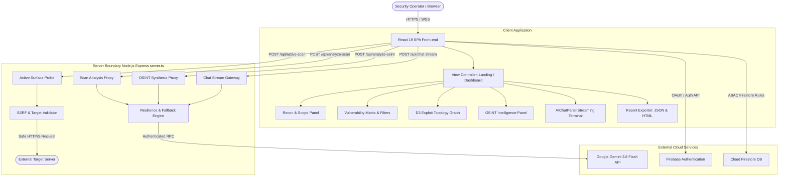
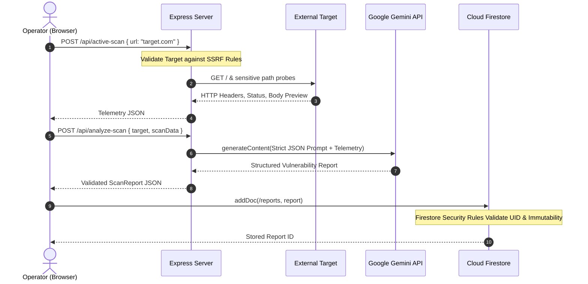

# AEGIS-AI Architecture & System Design Documentation

This document provides a technical overview of AEGIS-AI's architecture, security boundaries, component interactions, and deployment model.

---

## 1. High-Level Architecture Diagram

---

## 2. Component Responsibilities

### 2.1 Frontend Client (`/src`)
- **App.tsx:** Central state machine coordinating targets, scan execution, active views, report archives, and HUD overlays.
- **components/AIChatPanel.tsx:** Streaming chat interface that receives chunked model outputs from `/api/chat` and renders markdown payloads.
- **components/ExploitGraph.tsx:** Interactive D3.js and Graphviz WebAssembly engine visualizing vulnerability exploit relationships.
- **components/SecurityHUD.tsx:** Operator status overlay displaying verification tier, active MFA, session status, and quick brief extraction.
- **components/CyberAuth.tsx:** Cyber-noir authentication modal supporting Google OAuth and email/password with verification enforcement.
- **lib/validation.ts:** Client and server shared target URL validation and SSRF defenses.
- **lib/exporter.ts:** XSS-safe HTML and JSON report generator.
- **lib/firebase.ts:** Client-side Firebase SDK configuration, session token rotation, and error sanitization.

### 2.2 Server Architecture (`/server.ts`)
- **Express Middleware:** Hosts both production static assets and Vite development middleware.
- **Active Recon Probe (`/api/active-scan`):**
  - Performs non-destructive HTTP requests to discover headers, technology fingerprints, sensitive status codes, and robots policies.
  - Enforces SSRF filtering, rejecting localhost, private RFC 1918 subnets, and cloud metadata endpoints.
- **Gemini Synthesis Proxies (`/api/analyze-scan`, `/api/analyze-osint`, `/api/chat`):**
  - Keeps Gemini API keys strictly within server environment memory (`process.env.GEMINI_API_KEY`).
  - Implements automatic retries with exponential backoff on transient errors (HTTP 503, 429).
  - Implements multi-model failover (`gemini-3.8-flash` $\rightarrow$ `gemini-flash-latest` $\rightarrow$ `gemini-3.1-flash-lite`).

---

## 3. Data Flow & Security Boundaries

---

## 4. Security Boundaries & Threat Modeling

| Boundary | Mitigation Strategy |
| :--- | :--- |
| **User Input (Target URL)** | Target format validation; protocol restriction to HTTP/HTTPS; RFC 1918 private subnet blocking; loopback blocking; cloud metadata IP blocking (`169.254.169.254`). |
| **API Key Protection** | `GEMINI_API_KEY` is loaded exclusively in `server.ts`. Never defined in Vite client config or sent across browser networks. |
| **AI Output Sanitization** | Strict JSON schema parsing with fallback regex cleaning; report export engine escapes all strings to prevent stored XSS attacks. |
| **Database Access Control** | Cloud Firestore rules enforce Attribute-Based Access Control (ABAC); verified email requirement for writes; immutable report records; write-only audit logs. |
| **Information Disclosure** | Generic error handlers mask Firebase internal error messages (e.g., user-not-found returns uniform invalid credential alert to prevent account enumeration). |

---

## 5. Deployment Architecture

- **Development:** `tsx server.ts` boots Express with Vite middlewares in development mode on port 3000.
- **Production Build:** `npm run build` compiles frontend assets to `dist/`.
- **Production Runtime:** `node server.ts` serves static assets from `dist/` while exposing backend `/api/*` endpoints.
